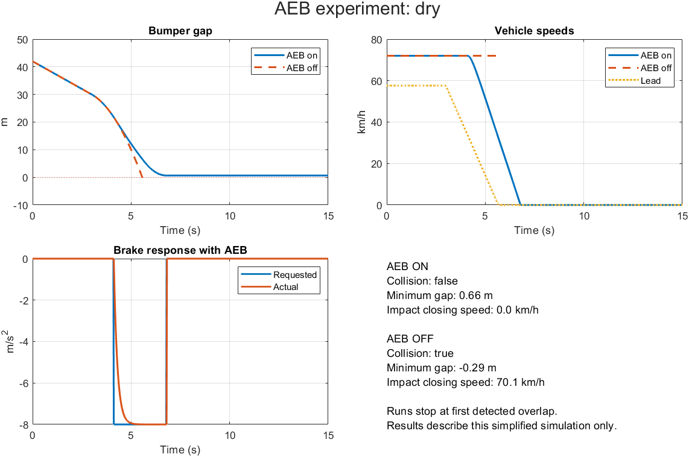

# AEB Simulation

Automatic emergency braking (AEB) simulation in MATLAB, with a matching Simulink model and an optional RoadRunner replay. The ego car follows a lead vehicle that brakes hard. A time-to-collision controller warns, then brakes, and switches to a fallback mode if the sensor drops out.



## Requirements

| Part | Needs |
|---|---|
| Simulation, interactive lab, tests, sweep | MATLAB R2024a |
| Block model | Simulink |
| 3-D replay | RoadRunner + RoadRunner Scenario (optional) |

## Usage

```matlab
aeb_lab                          % interactive lab with animation and plots
r = aeb_simulate(aeb_config);    % one run, no graphics
aeb_run_tests                    % behavioural and physics tests
aeb_sweep                        % 25 friction / sensor-delay combinations
run_aeb_simulink('dry')          % Simulink model, checked against the MATLAB reference
aeb_export_roadrunner(r)         % OpenDRIVE road + trajectory CSVs
```

## Scenarios

Dry, wet, ice, long sensor delay, sensor outage, stationary obstacle, safe following, and ACC + AEB.

## Structure

| File | Role |
|---|---|
| `aeb_config.m` | scenario settings (SI units) |
| `aeb_sensor.m` | gap, closing speed and validity |
| `aeb_controller.m` | warning, emergency brake, ACC, sensor-fault fallback |
| `aeb_plant.m` | first-order brake response, friction limit, longitudinal motion |
| `aeb_simulate.m` | closed loop |
| `build_aeb_model.m` | regenerates `AEB_ClosedLoop_R2024a.slx` |

The Simulink model uses the same MATLAB functions as the script, and `run_aeb_simulink` confirms both give the same result for all 8 cases (tolerance 1e-8). See [ROADRUNNER_README.md](ROADRUNNER_README.md) for the replay.

## Results

`results/` has the case summary, sweep output and the test log from the last full run.

## Limitations

Longitudinal only. No tire slip or ABS model, no object detection, and the controller knows the road friction exactly.
